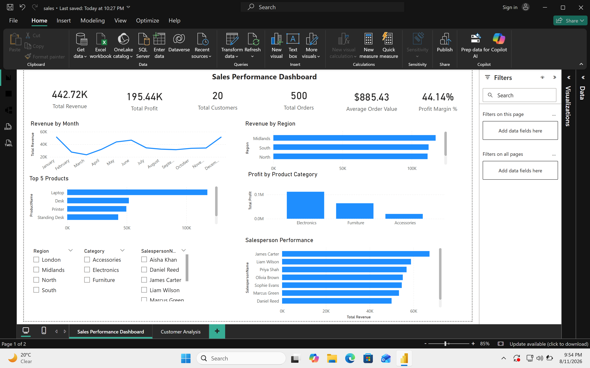
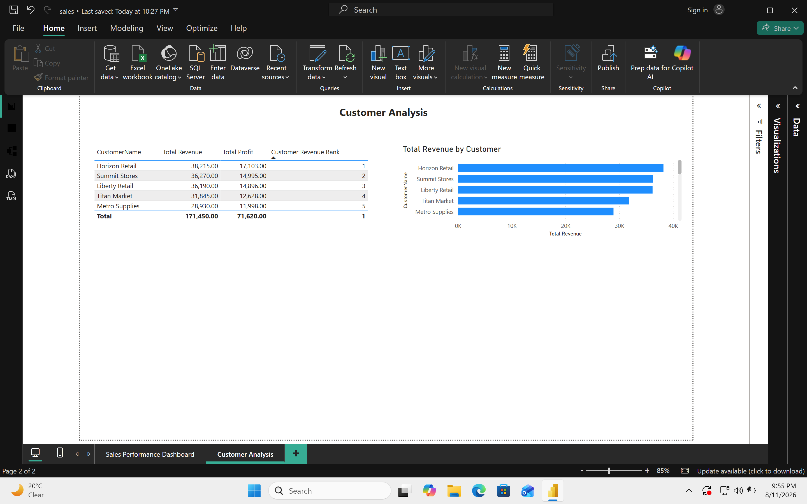

# Sales Performance Analytics Dashboard

## Overview

This project analysed sales data using SQL and Power BI to investigate differences in revenue, profitability and sales performance across customers, products, regions and salespeople. The aim was to identify where performance was strongest, where profit margins were weaker and which areas were driving overall business results.

Analytical Problem

Management needed a clearer way to understand which products, customers, regions and salespeople were contributing most to revenue and profit, and where weaker performance or lower margins might require attention.

What I Did

- Used SQL to calculate revenue, profit, order volumes and performance across customers, products, regions and salespeople
- Used JOINs, GROUP BY, CTEs and RANK window functions to compare performance and identify top-performing areas
- Built a relational data model connecting sales, customers, products and salespeople
- Created DAX measures for revenue, profit, average order value, profit margin and customer rankings
- Developed interactive Power BI dashboards with KPI cards, charts, tables and slicers to support detailed performance analysis
- Used Excel for initial data preparation and validation

Key Metrics
- Total Revenue
- Total Profit
- Total Orders
- Total Customers
- Average Order Value
- Profit Margin %
- Customer / Product Rankings

Business Value

The dashboard made it easier to identify the products, customers, regions and salespeople driving the strongest revenue and profit performance, while also highlighting areas with weaker margins or lower contribution. This gave management clearer evidence to support sales planning, performance monitoring and commercial decision-making.

## Dashboard Preview

